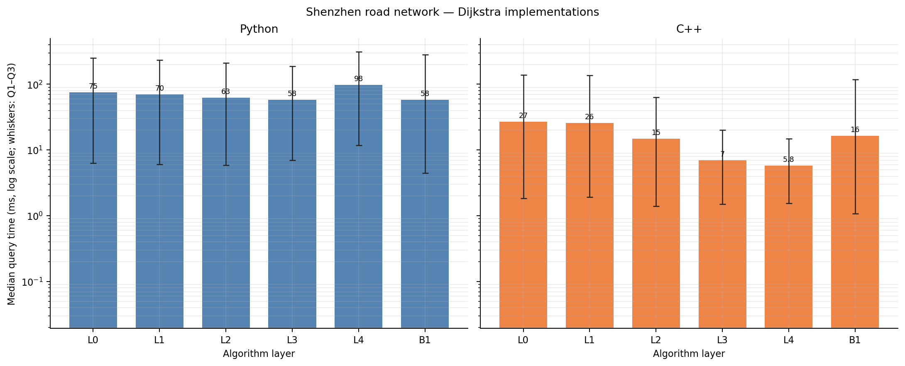
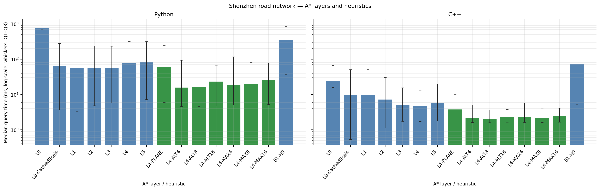

# 深圳路网 Dijkstra 与 A* 复现实验

实验批次：`20261017_175006_694300`。算法源码与原武汉实验相同；路网更换为 GitHub 的深圳 `road-d` 距离图及对应坐标，权重单位为米。

## 数据与实验设置

- 数据来源：[yzengal/RoadNetwork-China-City](https://github.com/yzengal/RoadNetwork-China-City) 的[深圳距离图文件](https://github.com/yzengal/RoadNetwork-China-City/blob/main/Shenzhen.road-d.tar.gz)及[数据说明页](https://yzengal.github.io/datasets/)；数据说明其 OSM 路网提取时间为 2021 年 2 月、网络类型为 car，距离图权重单位为米；深圳图标注 236,647 个节点、517,110 条边。
- 图策略：`shenzhen-github-osm-car-distance-2021`；保留下载图中的全部节点和有向边，不重新抽取道路、不裁剪连通分量；边 ID 按原文件行序编号。图 SHA-256：`b7937e8a7ae83aa178576c30cd67d9d1fec76ed0ab7e91765daba07134be839a`。
- 固定查询：100 对，随机种子 20261016；从最大 SCC 取端点，按端点 Haversine 直线距离分五档、每档 20 对。查询集 SHA-256：`e810f563a1deec722229c1a6f342fe33d87f1e956eca6d3eef8f0762c7f7b79b`。
- 计时：预热 5 对；5 轮；同一查询内随机打乱执行顺序。Dijkstra 按原 notebook 口径，先对每个查询的 5 次计时取中位数，再统计 100 个查询中位数及 Q1–Q3；A* 按其原 notebook 口径，直接对每配置、每语言的 500 次原始计时统计中位数及 Q1–Q3。A* 启发式和跨语言配对耗时比按相同查询、相同轮次的 500 对原始计时计算；“Python 较慢查询”按每查询 5 轮中位数比较。C++ 外层计时包含 ctypes 调用及结果转换，C++ 内核时间由库内 `steady_clock` 计量。
- 环境：Python 3.10.20、NumPy 2.2.6、SciPy 1.15.3；Dijkstra 1,200 次、A* 3,000 次语言/配置查询正确性检查均通过。

## Dijkstra 结果

### Python

| 层次 | 外层中位数 (ms) | Q1–Q3 (ms) | C++ 内核中位数 (ms) | 平均 settled 节点 |
| --- | --- | --- | --- | --- |
| L0 | 75.278 | 6.331–248.822 | — | 90,536.1 |
| L1 | 70.219 | 6.026–232.643 | — | 90,536.1 |
| L2 | 62.751 | 5.874–210.000 | — | 90,536.1 |
| L3 | 57.789 | 6.999–187.603 | — | 90,536.1 |
| L4 | 98.070 | 11.840–312.391 | — | 90,536.1 |
| B1 | 57.630 | 4.477–281.000 | — | 77,340.7 |

### C++

| 层次 | 外层中位数 (ms) | Q1–Q3 (ms) | C++ 内核中位数 (ms) | 平均 settled 节点 |
| --- | --- | --- | --- | --- |
| L0 | 27.094 | 1.843–138.682 | 27.009 | 90,536.1 |
| L1 | 25.851 | 1.915–135.976 | 25.780 | 90,536.1 |
| L2 | 14.790 | 1.397–63.198 | 14.689 | 90,536.1 |
| L3 | 7.035 | 1.516–20.240 | 6.957 | 90,536.1 |
| L4 | 5.757 | 1.544–14.802 | 5.668 | 90,536.1 |
| B1 | 16.327 | 1.074–118.435 | 16.267 | 77,340.7 |

### Python 与 C++ 配对对比

| 算法层 | Python 中位数 (ms) | C++ 外层中位数 (ms) | 配对耗时比 Python/C++ | Python 较慢查询 |
| --- | --- | --- | --- | --- |
| L0 | 75.278 | 27.094 | 2.54 倍（1.81–3.18） | 100/100 |
| L1 | 70.219 | 25.851 | 2.27 倍（1.70–2.92） | 100/100 |
| L2 | 62.751 | 14.790 | 3.33 倍（3.07–4.13） | 100/100 |
| L3 | 57.789 | 7.035 | 8.39 倍（4.58–8.97） | 100/100 |
| L4 | 98.070 | 5.757 | 16.95 倍（7.54–20.72） | 100/100 |
| B1 | 57.630 | 16.327 | 3.11 倍（2.41–3.82） | 100/100 |

| 语言 | 相邻层对比 | 配对中位提速 | Q1–Q3 |
| --- | --- | --- | --- |
| Python | L1 vs L0 | 6.83% | 3.91%–9.10% |
| Python | L2 vs L1 | 8.15% | -9.48%–10.49% |
| Python | L3 vs L2 | 4.62% | -28.76%–7.56% |
| Python | L4 vs L3 | -65.30% | -69.35%–-57.51% |
| Python | B1 vs L0 | 7.60% | -29.63%–32.08% |
| C++ | L1 vs L0 | 0.97% | -5.52%–4.11% |
| C++ | L2 vs L1 | 44.67% | 21.88%–52.47% |
| C++ | L3 vs L2 | 52.53% | -15.71%–66.80% |
| C++ | L4 vs L3 | 16.37% | 1.22%–28.11% |
| C++ | B1 vs L0 | 29.64% | -7.88%–46.91% |

## A* 结果

### Python：逐层实现改进

| 层次 | 中位耗时 (ms) | Q1–Q3 (ms) | 平均展开节点 |
| --- | --- | --- | --- |
| L0 | 766.633 | 686.543–939.546 | 55,455.0 |
| L0-CachedScale | 64.428 | 3.670–283.470 | 55,455.0 |
| L1 | 56.467 | 3.404–257.299 | 55,455.0 |
| L2 | 55.603 | 4.809–238.451 | 55,455.0 |
| L3 | 56.518 | 5.840–236.763 | 55,455.0 |
| L4 | 79.299 | 7.031–316.414 | 55,455.0 |
| L5 | 81.275 | 7.184–320.298 | 55,455.0 |
| B1-H0 | 357.102 | 37.954–862.253 | 100,910.7 |

### C++：逐层实现改进

| 层次 | 外层中位耗时 (ms) | Q1–Q3 (ms) | 内核中位耗时 (ms) | 平均展开节点 |
| --- | --- | --- | --- | --- |
| L0 | 24.498 | 15.858–66.977 | 24.421 | 55,455.0 |
| L0-CachedScale | 9.496 | 0.535–51.218 | 9.424 | 55,455.0 |
| L1 | 9.549 | 0.550–52.147 | 9.490 | 55,455.0 |
| L2 | 7.163 | 1.141–30.308 | 7.101 | 55,455.0 |
| L3 | 5.141 | 1.751–15.470 | 5.044 | 55,455.0 |
| L4 | 4.612 | 1.733–13.329 | 4.537 | 55,455.0 |
| L5 | 5.915 | 1.803–19.992 | 5.850 | 55,455.0 |
| B1-H0 | 74.136 | 5.155–255.869 | 74.042 | 100,910.7 |

### Python：启发函数与地标数

| L4 启发式 | 中位耗时 (ms) | 相对 L4 配对提速 | 平均展开节点 | 展开减少 |
| --- | --- | --- | --- | --- |
| L4 | 79.299 | 1.00 倍（1.00–1.00） | 55,455.0 | 0.0% |
| L4-PLANE | 60.638 | 1.25 倍（1.16–1.29） | 55,443.0 | 0.0% |
| L4-ALT4 | 15.815 | 2.21 倍（1.34–4.02） | 12,963.9 | 76.6% |
| L4-ALT8 | 16.695 | 2.62 倍（1.35–4.60） | 7,625.3 | 86.2% |
| L4-ALT16 | 23.365 | 2.18 倍（1.12–4.34） | 5,554.7 | 90.0% |
| L4-MAX4 | 19.061 | 1.76 倍（1.17–3.22） | 12,779.8 | 77.0% |
| L4-MAX8 | 19.991 | 2.23 倍（1.21–3.86） | 7,599.8 | 86.3% |
| L4-MAX16 | 25.265 | 1.97 倍（1.04–3.88） | 5,551.3 | 90.0% |

### C++：启发函数与地标数

| L4 启发式 | 中位耗时 (ms) | 相对 L4 配对提速 | 平均展开节点 | 展开减少 |
| --- | --- | --- | --- | --- |
| L4 | 4.612 | 1.00 倍（1.00–1.00） | 55,455.0 | 0.0% |
| L4-PLANE | 3.774 | 1.15 倍（1.05–1.27） | 55,443.0 | 0.0% |
| L4-ALT4 | 2.149 | 1.57 倍（1.09–2.53） | 12,963.9 | 76.6% |
| L4-ALT8 | 2.054 | 1.69 倍（1.11–2.99） | 7,625.3 | 86.2% |
| L4-ALT16 | 2.293 | 1.55 倍（1.07–2.78） | 5,554.7 | 90.0% |
| L4-MAX4 | 2.280 | 1.41 倍（1.07–2.29） | 12,779.8 | 77.0% |
| L4-MAX8 | 2.197 | 1.55 倍（1.09–2.65） | 7,599.8 | 86.3% |
| L4-MAX16 | 2.448 | 1.46 倍（1.05–2.51） | 5,551.3 | 90.0% |

### A* Python/C++ 对比

| 配置 | Python 中位数 (ms) | C++ 外层中位数 (ms) | 配对耗时比 Python/C++ | Python 较慢查询 |
| --- | --- | --- | --- | --- |
| L0 | 766.633 | 24.498 | 31.00 倍（13.82–44.52） | 100/100 |
| L0-CachedScale | 64.428 | 9.496 | 6.15 倍（4.66–7.14） | 100/100 |
| L1 | 56.467 | 9.549 | 5.43 倍（4.28–6.40） | 100/100 |
| L2 | 55.603 | 7.163 | 7.10 倍（4.24–7.96） | 100/100 |
| L3 | 56.518 | 5.141 | 11.23 倍（3.43–15.04） | 100/100 |
| L4 | 79.299 | 4.612 | 16.92 倍（4.20–24.99） | 100/100 |
| L5 | 81.275 | 5.915 | 13.26 倍（4.14–16.01） | 100/100 |
| L4-PLANE | 60.638 | 3.774 | 16.00 倍（3.81–24.61） | 100/100 |
| L4-ALT4 | 15.815 | 2.149 | 8.07 倍（2.94–18.54） | 100/100 |
| L4-ALT8 | 16.695 | 2.054 | 8.25 倍（2.87–17.86） | 100/100 |
| L4-ALT16 | 23.365 | 2.293 | 10.17 倍（3.09–18.16） | 100/100 |
| L4-MAX4 | 19.061 | 2.280 | 9.09 倍（3.21–19.55） | 100/100 |
| L4-MAX8 | 19.991 | 2.197 | 9.07 倍（3.07–19.09） | 100/100 |
| L4-MAX16 | 25.265 | 2.448 | 10.57 倍（3.30–18.44） | 100/100 |
| B1-H0 | 357.102 | 74.136 | 4.83 倍（3.43–6.17） | 100/100 |

## 预处理与结果解释

| 语言 | 预处理项 | 耗时 (ms) |
| --- | --- | --- |
| Shared | road/coordinate parse and CSR arrays | 832.713 |
| Shared | fixed-query SCC and stratified sampling | 52.494 |
| Python | adjacency and coordinate dictionaries | 338.234 |
| Python | Dijkstra L1 full-graph precheck | 302.029 |
| Python | Dijkstra B1 reverse graph | 192.462 |
| C++ | Dijkstra graph creation | 51.336 |
| C++ | A* graph creation | 18.126 |
| Python | A* graph_validation | 169.655 |
| Python | A* h0_scale | 787.141 |
| Python | A* plane | 317.912 |
| Python | A* reverse_graph | 175.262 |
| Python | A* landmark_selection | 1,480.810 |
| Python | A* alt_tables | 6,796.106 |
| C++ | A* geometry (outer) | 16.365 |
| C++ | A* geometry (kernel) | 16.354 |
| C++ | A* reverse graph (outer) | 25.500 |
| C++ | A* reverse graph (kernel) | 25.486 |
| C++ | A* ALT (outer) | 605.964 |
| C++ | A* ALT (kernel) | 605.919 |

Dijkstra 与 A* 的正式计时都不包含图下载、文本解析、图校验、CSR/邻接表构建、反向图构建、几何比例计算、SCC 计算、地标选择和 ALT 表计算；这些成本另列于上表。A* 的 ALT4/8/16 与 MAX4/8/16 共享一次 ALT-16 预处理表，查询时使用其前缀。

启发式实验固定在 L4 上进行；`MAX-k` 指 `max(H0, ALT-k)`。Dijkstra 配对变化的 Q1–Q3 按 100 个查询汇总；A* 启发式和 Python/C++ 配对耗时比的 Q1–Q3 按 500 组相同查询、相同轮次的原始计时比汇总；两者均是观测分布范围，不是置信区间。深圳图包含零权重边时，只有在端点球面距离为正的边才参与 H0/平面安全比例估计；本数据的 4 条零权重边端点坐标重合，因此不把安全比例压为零。

## 图表

## 复现文件与限制

原始代码和 notebook 未修改。脚本直接导入现有 A2 基线、各层 Python 实现及与其源码哈希匹配的 C++ DLL；本目录只新增深圳实验文件。原始数据来自 OSM 的 2021 年提取版本，不能据此代表当前深圳路况；这里比较的是固定图上的静态距离最短路，不含实时交通/时间权重。

结果文件：`dijkstra_python_raw.csv`、`dijkstra_cpp_raw.csv`、`dijkstra_python_summary.csv`、`dijkstra_cpp_summary.csv`、`dijkstra_cross_language.csv`、`astar_raw.csv`、`astar_summary.csv`、`astar_layer_analysis.csv`、`astar_heuristic_analysis.csv`、`astar_cross_language.csv`、`experiment_metadata.json`。
